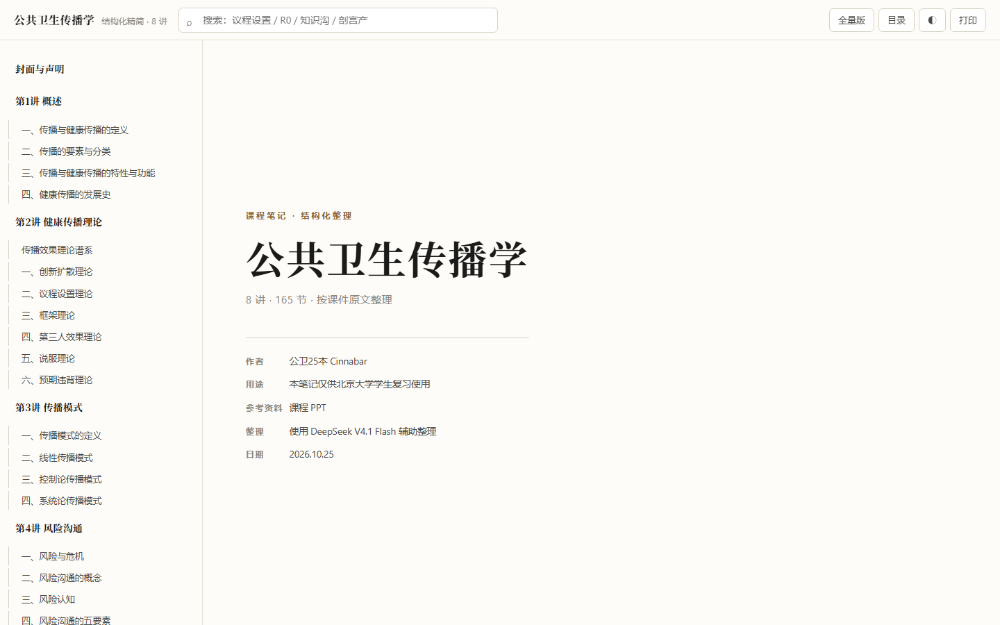

# 公共卫生传播学 · 复习笔记

> 8 讲课件整理成 **165 节结构化笔记**：一页一表，只搬运、不解释，页码可回查原 PPT。



## 声明

| 项目 | 内容 |
|---|---|
| 作者 | 公卫25本 Cinnabar |
| 用途 | 本笔记仅供北京大学学生复习使用 |
| 参考资料 | 课程 PPT |
| 整理 | 使用 DeepSeek V4.1 Flash 辅助整理 |
| 日期 | 2026.10.25 |

## 两个版本

| 版本 | 入口 | 体量 | 适合 |
|---|---|---|---|
| **精简版**（默认） | [`index.html`](index.html) | 165 节 | 复习、考前速览 |
| 全量版 | [`full/index.html`](full/index.html) | 295 页逐页原文 | 回查原 PPT 每一页 |

两个页面右上角可以互相切换。

## 内容

| 讲 | 主题 | 节数 |
|---|---|---|
| 1 | 概述 | 14 |
| 2 | 健康传播理论（创新扩散 / 议程设置 / 框架 / 第三人效果 / 说服 / 预期违背） | 38 |
| 3 | 传播模式（线性 / 控制论 / 系统论） | 11 |
| 4 | 风险沟通 | 34 |
| 5 | 传播材料制作与使用 | 18 |
| 6 | 大众传播 | 14 |
| 7 | 人际传播与效果 | 21 |
| 8 | 新媒体 | 15 |
| — | **合计** | **165** |

## 体例

- 每节标题即课件原标题，右侧灰色胶囊是原 PPT 页码（如 `P12`）。
- 正文只有表格和必要的原文段落：PPT 分四点就四行表，分三类就三列，不额外加“讲解”“考点”栏目。
- 年份、百分比、“第 N”自动加粗变墨绿，扫读时先抓这些。
- 错字、缺字、英文拼写错误按原文保留，不做改写。
- 已删除：封面、目录、课程安排、学生作品、致谢、参考文献、纯装饰图；授课教师姓名、院系、邮箱已去除。

## 使用

直接双击 `index.html`，浏览器打开即可，无需联网。

| 操作 | 说明 |
|---|---|
| 左侧目录 | 讲 → 小节，滚动时自动高亮当前节 |
| 顶部搜索 | 输入「议程设置」「R0」「知识沟」，回车跳到首个结果；`/` 聚焦，`Esc` 清空 |
| `←` `→` | 按小节翻页（底部也有翻页条） |
| `◐` | 浅色 / 深色 / 跟随系统 |
| 标题右侧 `#` | 复制该节链接 |
| 打印 | 隐藏侧栏与顶栏，A4 直接印或存 PDF |

手机上左上「目录」打开抽屉，表格可左右滑动。

## 目录结构

```
复习资料/
├─ index.html          # 精简版（Pages 入口）
├─ md/                 # 精简版源文件，01–08
├─ full/
│  ├─ index.html       # 全量版（295 页逐页原文）
│  └─ md/
├─ assets/cover.png
├─ README.md
├─ NOTICE.md
├─ .nojekyll
└─ .gitignore
```

## 本地更新

改完 `md/` 里的文件后重新生成：

```bash
python ../_extract/build_exam.py    # 精简版 → index.html
python ../_extract/build.py         # 全量版 → full/index.html
```

## 版权

笔记与整理部分采用 [CC BY-NC-SA 4.0](https://creativecommons.org/licenses/by-nc-sa/4.0/deed.zh)。
课程内容版权归授课教师及所在院校所有，详见 [`NOTICE.md`](NOTICE.md)。
